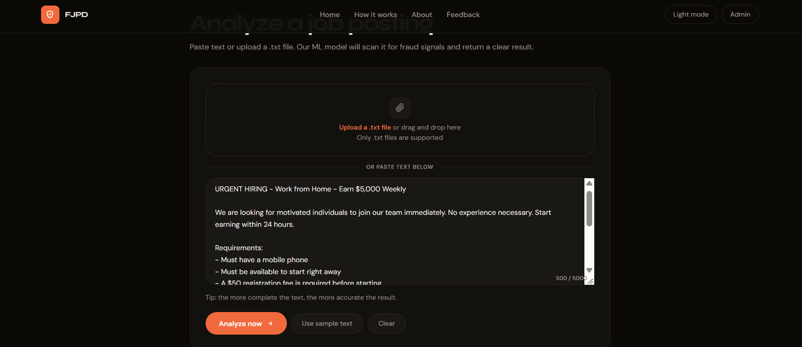
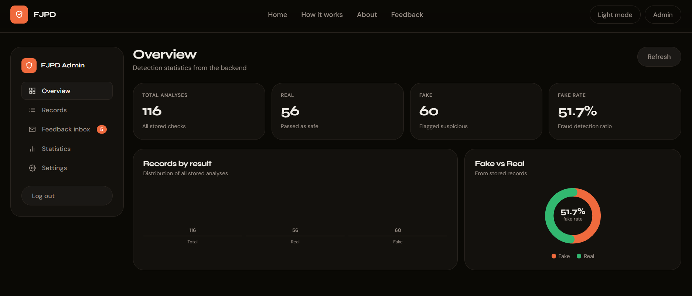

# Fake Job Posting Detection System (FJPD)

**A Machine Learning-Powered Web Application for Detecting Fraudulent Job Postings**

FJPD analyzes job advertisements and classifies them as potentially real or fake using Natural Language Processing (NLP) and machine learning.

🌐 **Live Demo:** [fakejobpostingdetector.com](https://fakejobpostingdetector.com/)

---

## Project Preview


## How It Works

### 1. Job Analysis Interface

Users can paste a job advertisement or upload a `.txt` file for analysis.


### 2. Job Advertisement Input

Example of a suspicious job advertisement submitted to the system for testing.



### 3. Fake Job Detection Result

The system displays its prediction, confidence score, and suspicious indicators identified during the analysis.


---

## Admin Dashboard

The project also includes an administrative interface for reviewing stored analyses and monitoring system statistics.

### 1. Overview Dashboard

Displays analysis totals, real and fake classifications, and summary statistics.



### 2. Records Management

Provides a view of stored job analysis records, including their classifications and confidence scores.


### 3. Statistics Dashboard

Presents a summary of detection results and system status.


---

## Key Features

- Machine learning-based job posting classification.
- Natural Language Processing (NLP) for text analysis.
- Job advertisement text input and `.txt` file upload.
- Prediction results with confidence scores.
- Suspicious indicator reporting.
- Administrative dashboard for stored records and statistics.
- Feedback functionality for users.

## Technologies Used

- **Python** — Backend and machine learning integration.
- **FastAPI** — Backend API.
- **Scikit-learn** — Machine learning and text classification.
- **TF-IDF** — Text feature extraction.
- **HTML, CSS, JavaScript** — Frontend interface.
- **SQLite** — Database storage.

## Project Structure

```text
fake-job-posting-detection-system/
├── DOCUMENTS/
├── PREREQUISITES/
├── SETUP/
├── SOURCE/
│   ├── backend/
│   │   ├── model/
│   │   └── routes/
│   └── frontend/
├── .gitignore
└── README.md
```

## Project Purpose

The goal of this project is to explore how machine learning and NLP can help identify suspicious job advertisements and support safer online job searching.

## Academic Project

Developed as a senior project to demonstrate practical skills in machine learning, text processing, backend development, and web application design.


## Academic Project
Developed as a senior project to demonstrate practical skills in machine learning, text processing, and web application development.
